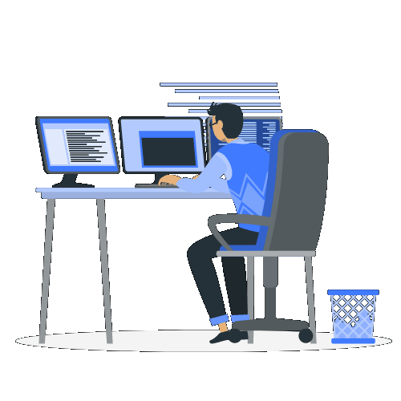

<h1 align="center">Hi 👋, I'm Ali Yasser Ali</h1>

<h3 align="center">Backend Developer | Computer Science Graduate</h3>

  

  

---

### 👨‍💻 About Me

- 🎓 Computer Science Graduate from Faculty of Science, Cairo University.
- 💻 Interested in Backend Development and API Development.
- 🚀 Working with .NET and C#.
- 📱 Have experience with Android Development.
- 🌱 Always learning new technologies and improving my skills.
- 💼 Open to new job opportunities.
- 📫 Reach me at: **ay6516169@gmail.com**

---

### 🤝 Connect With Me

  
  

---

### 💻 Programming Languages

  

### ⚙️ Backend & Frameworks

  

### 🗄️ Databases

  
  

### 🛠️ Tools & Development Environment

  

---

### 📊 GitHub Statistics

  
  

  

---

  <i>✨ Always learning, always building, always improving.</i>

